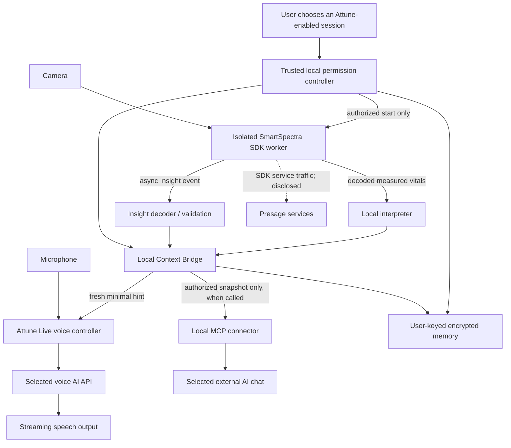

# ATTUNE — Privacy-First Real-Time Voice & AI Integration Plan

**Repository:** [`clatsonhacks/attune`](https://github.com/clatsonhacks/attune) (private)  
**Baseline:** `main`, reviewed through commit `571e0b9` (13 Nov 2026)  
**Plan date:** 18 Nov 2026  
**Status:** In progress — M0, M1, M3 done; M2 done except live-webcam validation (18 Nov 2026). Unchecked items below are still open.  
**Core constraint:** **Keep Presage SmartSpectra as the sensing SDK.** Disclose Presage Insights processing clearly, and let users opt into Attune sensing and separately into sharing approved context with an AI.

---

## 0. Executive decision

Build **two products on one privacy-controlled sensing engine**:

1. **Attune Live (P0, first):** An Attune-owned, real-time voice-to-voice assistant. The microphone/voice pipeline and SmartSpectra run **in parallel**. The AI can keep conversing without waiting for the SDK or a Presage Insight. Only a small, fresh, consented behavioral hint is supplied to the voice model when the integration supports it.
2. **Attune Connect (P1, later):** An optional, **per-session** skill + MCP connector for supported Claude/ChatGPT conversations. A skill guides use; it **does not** grant camera access or enable injection into every chat. External AI apps decide when to invoke tools. Attune cannot promise real-time background context injection through a standard MCP tool alone.

**Recommended deployment:** Local-first desktop app (initially Windows), native SmartSpectra process and local context service, with no Attune cloud service receiving camera frames, raw measurements or memory. If the user selects a hosted AI, minimal approved context and voice data will necessarily go to that provider. Presage's Insights feature also communicates physiological metrics to Presage; disclose this before starting sensing. Never claim that *no third party* has access to any SDK-derived data.

### Definition of success

- **The AI never blocks on sensing.** No SDK `requestInsight()` call is awaited in the voice response path.
- Camera and SDK measurements start **only after explicit human consent**, and stop on pause/revoke/end.
- Each OS user has separated session state and storage; a compromised web view cannot call unrestricted native SDK functions.
- Attune operators have no supported remote pathway to inspect a user's raw camera, raw metrics, transcripts or saved memory.
- Users can choose **Attune Live** or turn on **Attune Connect for this conversation only**.
- In all integrations, the AI receives no context if the session is not authorized, a signal is unreliable, or the data has expired.

---

## 1. Current repo audit: retain vs. fix

| Area | Existing code | Status / required action |
|---|---|---|
| Interpreter | `src/interpreter.js` | **Keep:** calibration, confidence gate, hysteresis, correction. Add reliability tests and timestamped snapshots. |
| Sensor adapter | `src/adapter/smartspectra.js` | **Keep SDK:** v3 Node integration and mapping. Add real SDK metrics needed for Insights, Insight event/decode, isolation and lifecycle. Live camera not yet validated. |
| Mock adapter | `src/adapter/mock.js`, `src/mockVitals.js` | **Keep:** deterministic demos and CI. Extend to simulate delayed/out-of-order Insights. |
| Session | `src/session.js` | **Refactor:** current context and signal handling into a consent-aware snapshot service. |
| MCP | `src/server.js` | **Refactor:** existing `grant_consent` is AI-callable; the AI must never be the authority granting human camera permission. Implement session-scoped authorization. |
| Demo backend | `src/webServer.js` | **Fix immediately:** adapter currently starts at server boot, before consent. Server uses HTTP and needs local-only binding/auth protection if retained. |
| Companion | `src/companion.js` | **Keep demo mode:** replace text/mock path with a distinct actual duplex voice engine. Do not confuse API usage with users' ChatGPT/Claude subscription logins. |
| Memory | `src/memory.js` | **Fix:** plaintext local JSON and seeded demo entries; add per-user encrypted storage and explicit retention/deletion. |
| UI | `web/` | **Reuse:** consent/companion/memory views. Add provider selector, consent disclosures and session-scoped controls. |
| Tests | `test-adapter.js`, `test-connector.js` | **Keep:** add unit, security, live-device, voice and CI tests. Existing tests are not proof of production readiness. |
| Connector UI | `src/webServer.js`, `web/app.js` | **Replace mock state:** current connect/disconnect changes an in-memory Boolean, not a real provider authorization. |

**Known correctness risks:** the web UI shows breathing/HRV values generated by a pulse-based simulation, not real SDK measurements; these must be labeled **demo/simulated** or replaced by supported SDK metrics. The local companion demo contains mock responses. `enableTelemetry: false` is not a switch to disable Presage Insights.

---

## 2. Target architecture



### Trust boundaries (strictly separate them)

- **Camera → SmartSpectra:** Video frames are handled locally by the SDK; Attune must not persist or log them. We must verify SDK/service behavior and respect its disclosures.
- **SDK → Presage:** SDK authentication and Insights can use Presage servers. A sandbox protects local users/processes; **it does not make Presage traffic disappear**. Do not intercept or modify its TLS traffic to claim privacy.
- **SDK → Attune local app:** Narrow IPC interface; avoid passing raw video/SDK handles into an untrusted renderer or MCP client.
- **Attune local app → selected AI:** Explicit opt-in; share the minimum behavioral hint needed. For hosted voice APIs, microphone audio also goes to the chosen service under that provider's terms.
- **Attune Connect → host application:** MCP is typically **pull-based**: the host calls a tool when it wants data. It is not an always-on stream into an arbitrary existing chat.

### Per-user sandbox model

**Start practical, then strengthen:** separate per-OS-user application data, per-session worker processes, scoped IPC capabilities, encrypted storage and network allowlists compatible with SDK operation. Electron's renderer sandbox/context isolation is useful **but not a complete native process sandbox**; add OS-specific restrictions and a threat-model review for the SDK worker. A server-side Docker container alone does not prevent the server operator from inspecting data.

**Threat-model exclusions that must be stated:** an administrator/root user, compromised OS, malicious signed update, SDK vendor, hosted voice/AI provider, and malware may bypass some protections. The goal is *no Attune-developer-accessible raw-data service*, not an impossible claim that absolutely nobody can ever access anything.

---

## 3. Data contracts and non-blocking behavior

### 3.1 Local context snapshot (example)

```json
{
  "sessionId": "local-session-id",
  "sequence": 42,
  "state": "elevated",
  "confidence": 0.76,
  "observedAtMs": 1795039200000,
  "expiresAtMs": 1795039205000,
  "source": "local_interpreter",
  "guidance": "Speak more slowly and invite a correction; do not infer an emotion or diagnosis.",
  "consentScope": "attune-live"
}
```

This is an **internal illustrative schema**, not a claim about the SmartSpectra protobuf. Do not include pulse BPM, raw video, unbounded user notes, identity data or unverified emotion labels in the AI-facing payload. Prefer a separate `getApprovedContext()` that strips internal fields, including `sessionId` if unnecessary.

### 3.2 Context Bridge rules

- SDK stream ingestion and Presage Insight callbacks run **independently** of the speech/audio path.
- Maintain the **latest valid state** in local memory; each accepted update has a monotonic sequence and timestamp.
- A voice turn reads a local cache (no network wait); older Insights never overwrite newer relevant context without explicit rules.
- Reject stale/low-confidence, malformed, contradictory, duplicate and post-revocation updates.
- Coalesce changes with cooldown, hysteresis and rate limits; **no per-frame model messages**.
- Suggested defaults to evaluate (not validated): 5-second expiry for short-term state; send on meaningful state change, no more often than once per 10–20 seconds unless safety/consent requires immediate invalidation.
- Ignore late insight callbacks after session closure; avoid accidental cross-session delivery.
- Never interrupt mid-sentence simply to announce a stress inference. Apply new guidance on a later safe turn boundary unless user explicitly asks for a body-context update.
- The human can correct a false inference; save correction only if memory consent is on.

### 3.3 Two SDK information paths

**Fast path:** Decoded `metrics` event → local interpreter → Context Bridge.

**Slow path:** SDK's **automatic** Insights and optionally rate-limited, user-initiated `requestInsight(text)` → async `insight` callback → protobuf decode → sanitize/filter → Context Bridge. Do not await the request in a live speech turn. According to Presage's Node documentation, the `insight` payload requires decoding the `Insight` protobuf with an app-provided decoder; the SDK doesn't ship that decoder. A single `'insight'` callback is registered and should multiplex responses by `requestId`.

**SDK config work:** Confirm version compatibility and use the documented `requestedMetrics: [...breathingMetrics, ...cardioMetrics]` for Insights. Display only measured SDK breathing/HRV readings, or `unavailable`. Avoid turning an Insight into a diagnosis or lie-detection claim.

---

## 4. Consent UX — what the user actually agrees to

**Before `SDK.start()`**, show a non-coercive consent screen with clear, separate disclosures:

1. **Local camera measurement:** Attune uses the camera and SmartSpectra to estimate supported physiological signals; accuracy and conditions vary. An OS camera prompt is additional, not a substitute for Attune consent.
2. **Presage service processing:** Presage SDK may communicate with Presage for authentication and automatically generated Insights, including transmitting physiological metrics and any on-demand Insight prompt. Link the SDK vendor's current privacy policy. If these transmissions cannot be disabled in the supported SDK version, **do not present an Insights-off toggle that secretly leaves them on**. Declining this disclosure prevents starting the SDK.
3. **Attune AI sharing (optional):** Whether a small approved behavioral hint may be given to the selected AI. Off by default. Hosted AI voice requires a separate disclosure of microphone/audio transfer.
4. **Local memory (optional):** Store interpretations/corrections using a user-controlled encrypted store; off by default; explain retention and forget controls.
5. **Optional diagnostics:** Keep `enableTelemetry: false` unless the user expressly opts into supported telemetry (SDK telemetry and Insights are different data flows).

**State machine:** `idle -> consented -> starting -> calibrating -> active -> paused/revoked -> stopped`, plus `error` and `device_unavailable`. Restart from paused only with an appropriate still-valid permission. Stop and destroy the SDK on revoke/exit; cancel UI updates, revoke IPC tokens, clear transient queues and prevent late callbacks from being delivered. Explain that revocation cannot erase data already transmitted to external providers.

**UX acceptance tests:**
- Before consent: OS camera closed, no SDK sample acquisition, no raw pulse in `/api/state`, no AI context, no saved session events.
- If user denies Presage disclosure: no SDK measurement session starts.
- While context-sharing consent is off: AI sees no physiological hints even if the camera session is running.
- On revoke: camera released; audio/AI can continue without body context if independently authorized; no later SDK callback is accepted.
- App restart: permissions are evaluated under the intended policy; never silently resume recording.

**Suggested copy (draft):**
> Attune uses your camera and Presage SmartSpectra to estimate physiological signals. Video is processed locally by the SDK; Presage services may receive physiological measurements for Insights and required service operations. Attune does not send your camera video or raw measurements to its own servers. If you enable AI sharing, Attune sends short interpreted guidance to the AI you choose. You can pause sensing at any time. Attune is not a medical or emotion-detection tool.

Do a legal/privacy review before releasing final language.

---

> **Decision 19 Nov 2026 (product owner):** consent is asked once and remembered. The camera starts on chat start or
> when the AI asks (tool call), stops after 5 min idle, with a visible badge, sticky pause and one-click forget. This
> replaces "never silently resume" in §4: restarts restore *permission*, never a running camera.

## 5. Milestone roadmap (GitHub-ready checklist)

### M0 — Freeze, test and specify the baseline (P0)

**Goal:** Prevent regressions while changing the prototype.

- [x] `M0-01` Create `docs/ARCHITECTURE.md`, `docs/DATA_FLOW.md`, and this roadmap in a new branch when implementation starts.
- [x] `M0-02` Write a concise threat model: normal user, malicious website, untrusted MCP client, other local OS user, cloud operator, SDK vendor, hostile process, stolen laptop, compromised update.
- [x] `M0-03` Pin SDK/runtime versions and validate actual Node SDK contracts; inspect callback shapes for `metrics`, `insight`, `start`, `stopAsync` and `destroy`.
- [x] `M0-04` Run current commands: `npm install`, `npm run demo`, `npm run test:connector`, `npm run test:adapter`, `npm run web`. Capture results; tests are not assumed passing until executed.
- [x] `M0-05` Decide MVP platform: **Windows x64 first**; confirm camera, dependencies and build packaging there.

**Done when:** A documented baseline, SDK-version matrix and repeatable test run exist.

### M1 — Consent and local privacy boundary (P0; security gate)

- [x] `M1-01` Move SDK startup **out of module/server boot** and behind trusted user consent; prevent AI-driven `grant_consent` from authorizing a human camera session.
- [x] `M1-02` Implement the disclosure/consent state machine; separate sensing, AI context sharing, memory and optional diagnostics.
- [x] `M1-03` *(HTTP guarded; IPC for the packaged app comes with M5)* Bind any HTTP service to `127.0.0.1`, add short-lived random session authentication, strict origin/CSRF protections and localhost-only policy; prefer authenticated IPC to HTTP in packaged desktop builds.
- [x] `M1-04` *(child-process worker with allowlisted IPC + minimal env; not an OS sandbox)* Isolate the SDK in a worker/child process; restrict its IPC to `start`, `stop`, `status`, valid samples and Insight notifications. No renderer-side unrestricted SDK handles.
- [x] `M1-05` Remove raw metric exposure before consent and remove pulse-change numbers from all **AI-facing** outputs. If showing a numeric pulse to the user, make it clear that it is locally measured and consented.
- [ ] `M1-06` *(partial: logs carry no body data, AI paths are number-free; network audit not done)* Disable raw body data, voice transcripts and API secrets in logs, error telemetry and crash reports; audit actual SDK/service traffic and publish a precise data-flow table.
- [x] `M1-07` *(`tests/privacy`: revoke, late callbacks, worker crash, device disconnect, OS permission failure, restart)* Add tests for revoke, crash, OS permission failure, device disconnect, restart, and late callbacks.

**Done when:** No camera activity occurs before human consent; revoke reliably releases it; unauthorized chat/MCP clients cannot enable sensing or retrieve body context.

### M2 — Real SmartSpectra metrics and Insights integration (P0)

- [x] `M2-01` Request the SDK's documented cardio + breathing metric sets; preserve low-confidence/invalid states.
- [x] `M2-02` *(schema from Presage Data Types docs, protobufjs 7.6.6)* Add a pinned, tested protobuf decoder for the Presage `Insight` schema; register a single `insight` callback.
- [x] `M2-03` *(requested vs automatic by request id; errors/duplicates/out-of-order handled in the bridge)* Distinguish automatic versus requested Insights via request IDs and event metadata; handle missing, error, duplicate, delayed and out-of-order responses.
- [x] `M2-04` *(done early: real mode shows breathing/HRV as unavailable)* Remove simulated breathing/HRV from real mode, while retaining clearly marked mock demo data.
- [ ] `M2-05` *(partial: face-not-found verified on Windows; face-in-view, lighting, movement, long runs not yet)* Validate real webcam baseline, face-not-found, poor lighting, subject movement, camera contention, SDK errors and long-running sessions on Windows.
- [ ] `M2-06` Test when automatic Insights arrive and whether SDK auth/service traffic matches the consent disclosure. Do **not** promise that SDK Insights can be disabled without documentation proving it.

**Done when:** Recorded/video fixture tests and at least one physical webcam run confirm measured inputs and async Insight behavior; no simulated measurement is mislabeled as real.

### M3 — Non-blocking Context Bridge (P0)

- [x] `M3-01` Implement `src/contextBridge.js`: latest snapshot, TTL, event sequencing, confidence, cooldown, dedupe, consent scope.
- [x] `M3-02` Implement `src/insights/decoder.js` and `src/insights/normalizer.js`; strip medical certainty, raw measurements, identifying text and unsolicited instructions before model sharing.
- [x] `M3-03` Add `getApprovedContext(sessionCapability)` and `subscribeApprovedContext(sessionCapability)`; reject unauthorized consumers and stop subscriptions immediately on revoke.
- [x] `M3-04` Extend mock source with fake callbacks that arrive late, never arrive, or conflict with the current state.
- [x] `M3-05` *(counters only, `/api/bridge/stats`)* Instrument **only non-sensitive** queue delays, dropped updates, permission-denied counters and context-append delivery/ack states. Require explicit diagnostics opt-in if logs could identify a user.

**Done when:** Voice can get an immediate cache read; a slow or failed Presage Insight never stops conversation; no data crosses sessions or revoked scopes.

### M4 — Attune Live: real voice-to-voice companion (P0; MVP showcase)

- [ ] `M4-01` Create `src/voice/` provider-independent interface: `start`, `stop`, `onUserSpeech`, `onAssistantSpeech`, `appendContext`, `interrupt`, `status`.
- [ ] `M4-02` Use a supported streaming speech-to-speech provider for the first implementation (recommended investigation: **GPT-Live**). Keep API credentials out of UI code; use approved short-lived credentials and documented session authentication.
- [ ] `M4-03` Ensure mic/audio path and SDK/Insights path are concurrent. Never await Insight generation or SDK metrics inside speech callbacks.
- [ ] `M4-04` On meaningful state changes, supply quiet, short context when the model API supports it. GPT-Live documents `session.thinking.append` as a candidate; its acknowledgment indicates delivery to the session timeline, **not guaranteed immediate use by speech**. Validate the current schema at implementation time.
- [ ] `M4-05` Implement barge-in/interruptions, reconnection, audio-device switching, speech failure fallback, and continuation when camera sensing is paused.
- [ ] `M4-06` Add user-visible AI provider disclosure, microphone permission and privacy control independently of sensing permission.
- [ ] `M4-07` Evaluate latency, false inferences, model behavior and cost. Default to tentative wording; never assert that pulse/expression proves an emotion or that a user is lying.

**Done when:** In a live 10-minute voice session, the user can converse with natural turn-taking while sensing runs in parallel; deliberately delaying/dropping Insights does not delay speech; revoking sensing does not terminate voice unnecessarily.

### M5 — Encrypted local memory and desktop packaging (P0 before beta)

- [ ] `M5-01` Replace `.attune-memory.json` with per-user encrypted-at-rest storage; put keys in Windows DPAPI/Credential Manager initially, with keychain/keyring alternatives for later OS releases.
- [ ] `M5-02` Implement user-selectable retention, private mode, per-day deletion, full deletion, and no silent demo-memory seeding in production.
- [ ] `M5-03` Package Electron with renderer sandbox/context isolation, `nodeIntegration: false`, restrictive CSP, tight IPC schemas and no remote-code injection path. Audit native SDK worker separately.
- [ ] `M5-04` Ship correct Presage native runtime for the target OS, protect application/API keys, sign releases and validate camera permissions on clean machines.
- [ ] `M5-05` Add security regression tests for cross-user files, unauthorized API calls, memory erasure and errors that would log sensitive values.

**Done when:** Installed Windows app can run as a non-admin user, persist encrypted user-approved memory and delete it; a separate OS user cannot casually read it; no developer cloud stores the user's raw inputs.

### M6 — Attune Connect: selectable skill and MCP (P1, after Live)

- [ ] `M6-01` Rewrite `SKILL.md`: clearly state **opt-in only**, tool-pull constraints, confidence/expiry behavior, permission requirements and safe response handling.
- [ ] `M6-02` Update MCP tool set: read-only `get_latest_context` and `get_attune_status` plus optional user-authorized correction/memory operations. Keep consent managed by trusted local UI, **not** an MCP tool an AI can call freely.
- [ ] `M6-03` Issue short-lived, session-specific capability tokens scoped to `provider`, `session`, `purpose`, and `expiresAt`, invalidated on revoke/close. The AI cannot self-authorize additional sessions.
- [ ] `M6-04` First integration: **Claude Desktop local MCP** if supported by the current client setup; verify actual end-to-end behavior rather than relying on example config alone.
- [ ] `M6-05` Next integration: ChatGPT custom plugin via supported remote MCP or secure tunnel, with a user-authorized pairing flow. Never expose an unauthenticated localhost port or a globally readable remote endpoint.
- [ ] `M6-06` Evaluate remote bridge designs carefully: service-side relay would see any context it decrypts; prefer a user-controlled tunnel/forwarding architecture and disclose all transferred data. Decide whether a strict **Attune cannot view data** promise permits a shared gateway at all.
- [ ] `M6-07` Verify platform tool invocation behavior in voice/text; avoid promising push-to-running-conversation functionality when the host provides only tool calls. Provide manual/triggered context reads as fallback.
- [ ] `M6-08` Remove the simulated `connected` status flags from the web UI and show real registration, permissions and expiry.

**Done when:** User can explicitly enable Attune for one supported chat, retrieve a fresh authorized context snapshot, revoke access, and keep Attune disabled elsewhere. Document host-specific limitations honestly.

### M7 — Hardening, beta and review (P1)

- [ ] `M7-01` Add CI for unit, lint/security and mock-integration tests; keep camera-required and paid-API runs in a separate opt-in workflow.
- [ ] `M7-02` Run privacy/network audit: camera data, metrics, microphone/audio, Presage Insight prompts, local memory, app logs, MCP traffic, SDK telemetry and diagnostics.
- [ ] `M7-03` User studies for false positives, trust, interruption annoyance, accessibility and reliable consent comprehension.
- [ ] `M7-04` Publish user-facing privacy policy, third-party disclosure, SDK license notices, non-medical limitations and data deletion guide.
- [ ] `M7-05` Perform dependency/security review, signature/update testing and crash/restart tests; fix critical findings before beta.

**Done when:** A reproducible release and documented privacy behavior exist; critical issues and known host limitations are tracked.

---

### M8 — Lenses: one sensing core, many purposes (P1, started 19 Nov 2026)

**Goal:** any AI app can use Attune; a lens matched to its task decides what it may see, and the person approves
each app for each purpose.

- [x] `M8-01` Lens registry + companion lens (identical output to before) + neutral snapshot + lens-aware bridge reads.
- [ ] `M8-02` Yoga/breathwork lens (may share breathing rate and target pace only) and casual-chat lens.
- [ ] `M8-03` Per-app lens approvals stored locally; connector `get_body_context({ purpose })`, `list_purposes`;
  unapproved purposes are recorded as requests, never auto-approved.
- [ ] `M8-04` Local activity log (which app read which lens, when — no directives or numbers).
- [ ] `M8-05` UI: approve purposes per app, pending requests, activity page, built-in companion mode switch.
- [ ] `M8-06` Later: gaming lens with anti-engagement rules (breaks/difficulty only, never monetisation);
  exercise lens for recovery between sets only (webcam signal fails during motion).

## 6. Recommended implementation order and release gates

| Order | Milestone | Priority | Release gate |
|---:|---|---|---|
| 1 | M0 Baseline + threat model | P0 | Tests can be reproduced |
| 2 | M1 Consent + boundaries | **P0/blocker** | Camera remains off before consent |
| 3 | M2 Real metrics + async Insights | P0 | No simulated vitals in real mode |
| 4 | M3 Context Bridge | P0 | Voice code never awaits Insights |
| 5 | M4 Attune Live | P0 | Working concurrent voice and sensing |
| 6 | M5 Encryption + packaging | P0 before beta | Installed privacy-safe local app |
| 7 | M6 Attune Connect | P1 | Scoped optional external integrations |
| 8 | M7 Hardening + beta | P1 | Audited, tested build |

**Do not block the first voice MVP on integrations with third-party ChatGPT/Claude conversations.** The host restrictions make Attune Connect a separate, riskier track. Validate your core value with Attune Live first.

### Critical path for the first demonstrable build

`Human consent -> SDK starts -> Real sample or mock -> Interpreter -> Cached context -> Live voice AI -> Non-blocking Insight update -> Gentle next-turn change -> Pause/revoke`.

### Explicitly deferred (not MVP)

- Automatic installation into every AI chat or universal always-on injection.
- Cloud camera capture or server-side multi-tenant containers.
- Diagnosis, emotion certainty, lie detection, emergency-health claims.
- Complex recommendation/personalization based on long-term biometric history.
- Recording raw video/audio, or sending raw physiological histories to generic LLMs.

---

## 7. Suggested directory structure

```text
attune/
├── src/
│   ├── adapter/
│   │   ├── smartspectra.js           # keep; add async Insight lifecycle
│   │   └── mock.js                   # keep; add delayed/failure fixtures
│   ├── interpreter.js                # keep and validate
│   ├── contextBridge.js              # NEW: snapshot, TTL, coalescing
│   ├── insights/
│   │   ├── decoder.js                # NEW: Presage Insight protobuf
│   │   └── normalizer.js             # NEW: safe, grounded guidance
│   ├── privacy/
│   │   ├── consent.js                # NEW: trusted consent state machine
│   │   ├── capabilities.js           # NEW: scoped session permissions
│   │   ├── storage.js                # NEW: encrypted persistence
│   │   └── audit.js                  # NEW: data-flow and minimal diagnostics
│   ├── voice/
│   │   ├── provider.js               # NEW: abstract real-time interface
│   │   ├── live.js                   # NEW: first live voice provider
│   │   └── session.js                # NEW: voice/conversation manager
│   ├── desktop/
│   │   ├── main.js                   # NEW: Electron main process
│   │   └── preload.js                # NEW: narrow UI IPC bridge
│   ├── server.js                     # refactor MCP permissions/tools
│   ├── webServer.js                  # refactor/remove insecure demo API
│   └── memory.js                     # replace plaintext persistence
├── web/                              # reuse existing views/styles
├── tests/
│   ├── privacy/
│   ├── insights/
│   ├── context-bridge/
│   ├── voice/
│   └── e2e/
├── docs/
│   ├── ARCHITECTURE.md
│   ├── DATA_FLOW.md
│   ├── PRIVACY_DISCLOSURES.md
│   └── ATTUNE_IMPLEMENTATION_PLAN.md
└── SKILL.md                          # rewrite for optional session use
```

Directory names are recommendations, not existing paths.

---

## 8. Definition of Done — test checklist

### Functional

- [ ] Real SDK measurements populate only supported, properly labeled fields.
- [ ] Automatic and on-demand Insights are decoded and processed asynchronously; callback may never arrive without stalling the UI.
- [ ] Voice responds naturally while camera acquisition and Insights run independently.
- [ ] The AI stays conversational with camera off, low signal or revoked consent.
- [ ] Slow Insights alter **later** appropriate responses, not forcibly interrupt current speech.
- [ ] User correction lowers future unwarranted prompts and cannot create a medical assertion.

### Privacy and security

- [ ] No capture before human consent, including web/API/auto-start paths.
- [ ] Revocation stops and releases the SDK camera and invalidates all authorized context consumers.
- [ ] No raw video is saved or sent to Attune infrastructure; verify with code audit and local network observation.
- [ ] Presage authentication and Insights traffic are disclosed accurately; `enableTelemetry: false` is separately verified.
- [ ] No raw vitals or session memory in LLM prompts, MCP results or server logs beyond explicitly approved minimal context.
- [ ] Encrypted memory uses a per-user OS-protected key; cross-user access attempts fail under normal OS permissions.
- [ ] Hosted voice and external AI transmissions are described and approved independently of SDK sensing.
- [ ] The app refuses remote MCP requests without a valid, scope-limited user-authorized session.

### Reliability and measurement

- [ ] Tests for missing face, low light, invalid confidence, no network, SDK authentication error, microphone failure and device unplug.
- [ ] Tests for duplicate/stale/out-of-order SDK events, memory write failures, pause/restart and crash recovery.
- [ ] Benchmarks for voice response latency with sensing disabled vs. enabled; measure p50/p95 and set thresholds from the baseline rather than inventing an SLA.
- [ ] CI produces repeatable test reports; field/device tests run on supported hardware.

---

## 9. Decisions and unresolved dependencies

| Decision / uncertainty | Recommended resolution |
|---|---|
| Does current SmartSpectra SDK send periodic Insights by default? | **Yes according to SDK docs**; disclose the default and validate real network behavior. |
| Can Insights be disabled without disabling metrics? | **Unverified**; confirm with Presage's supported SDK API before offering an Insight-off switch. |
| Is `enableTelemetry: false` enough to stop physiological data sharing? | **No** — telemetry is a separate feature from Insights/auth. |
| What if the model speaks before a new Insight arrives? | Continue naturally. Cache the update and apply it at a safe later point; never await the Insight. |
| Can a skill make ChatGPT/Claude call Attune before each spoken sentence? | **Not guaranteed.** Tool calls and their timing belong to the host; optional connector uses pull-based snapshots. |
| Can the user connect their consumer ChatGPT/Claude subscription as an API key? | **Do not assume so.** Attune Live needs supported developer/API authentication or Attune-managed access. |
| Is Electron renderer sandbox equivalent to isolating the native SDK? | **No**. Review and harden native process permissions and IPC separately. |
| Can Attune claim “developer has zero access” with a remote gateway? | Only after architecture-specific review; no Attune server should decrypt/store raw data or model context. Avoid overclaiming. |
| Is data never sent to any third party? | **No** when using Presage Insights and hosted voice/AI providers. Use accurate, purpose-specific disclosures. |

---

## 10. References (review again before implementation)

- [Attune repository README](https://github.com/clatsonhacks/attune/blob/main/README.md) — existing features and scripts.
- [SmartSpectra Node/Electron SDK](https://smartspectra.presagetech.com/docs/nodejs) — runtime, camera, Electron and IPC integration.
- [SmartSpectra Node LLM Insights](https://smartspectra.presagetech.com/docs/nodejs/llm-insights/) — required metrics, `requestInsight`, async callback and decoding contract.
- [SmartSpectra telemetry/privacy](https://smartspectra.presagetech.com/docs/telemetry-and-privacy/) — difference between optional SDK telemetry and other service traffic.
- [Presage privacy policy](https://api.physiology.presagetech.com/privacypolicy) — disclosure and consent responsibilities.
- [OpenAI Live sessions](https://developers.openai.com/api/docs/guides/live-conversations) — appending context during a voice session, acknowledgment caveats.
- [OpenAI realtime voice architecture](https://developers.openai.com/api/docs/guides/audio) — speech-to-speech options.
- [OpenAI custom MCP/plugin documentation](https://developers.openai.com/api/docs/guides/custom-mcp-server) — current connection and permission support.
- [Claude local MCP setup](https://support.claude.com/en/articles/10949351-getting-started-with-local-mcp-servers-on-claude-desktop) — local integration path.
- [Claude remote connector documentation](https://support.claude.com/en/articles/11175166-get-started-with-custom-connectors-using-remote-mcp) — remote MCP access and network constraints.

---

## 11. Next development action

**Done:** M0, M1, M3; M2 apart from live-webcam validation (M2-05, M2-06).  
**Next:** a live webcam run with a face in view (M2-05/06), then M4 Attune Live voice on top of `contextBridge.subscribe()`.

**First concrete code task:** Refactor `src/webServer.js` and `src/server.js` so the SDK cannot start until a trusted local user explicitly consents, and so an AI/MCP call cannot grant consent. Add tests covering before-consent, revoke and SDK startup failure. This removes the most serious privacy gap before adding voice or additional Insight integration.
